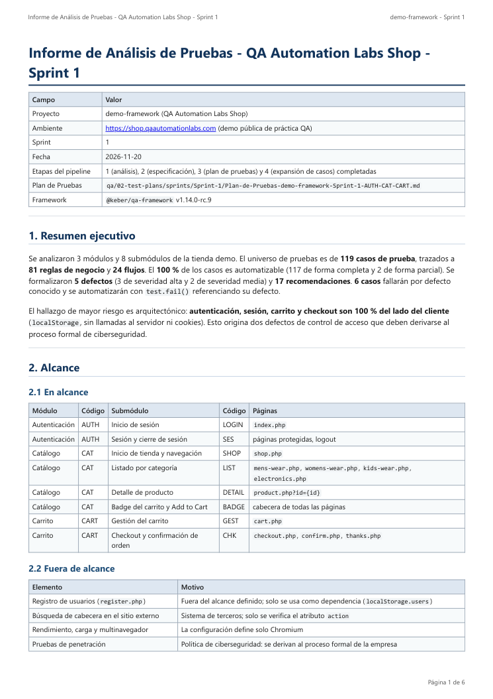
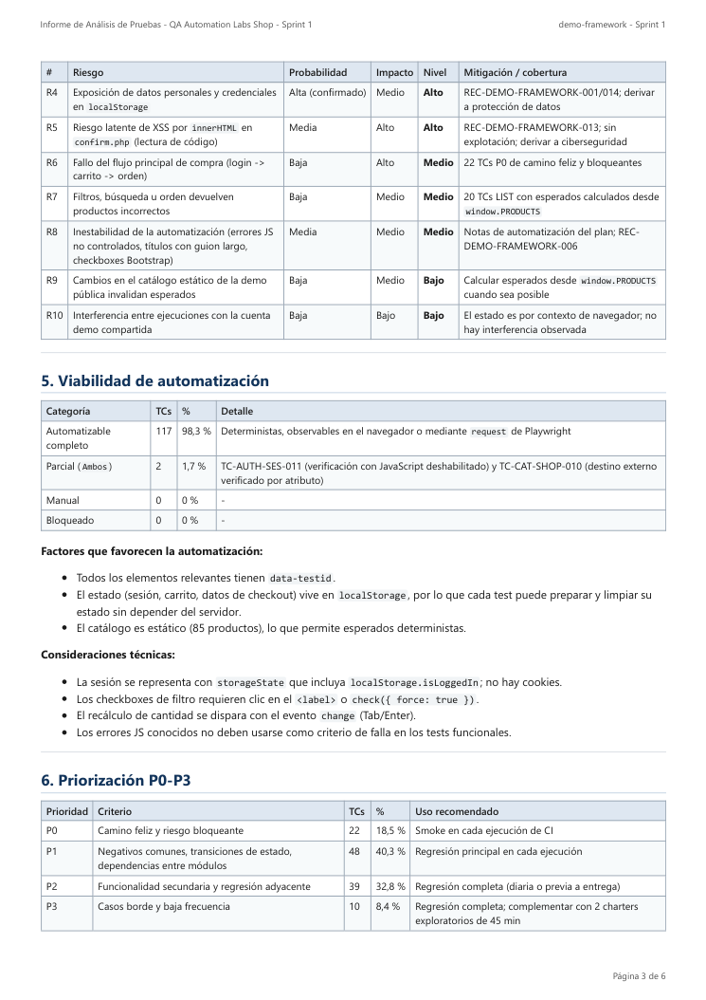
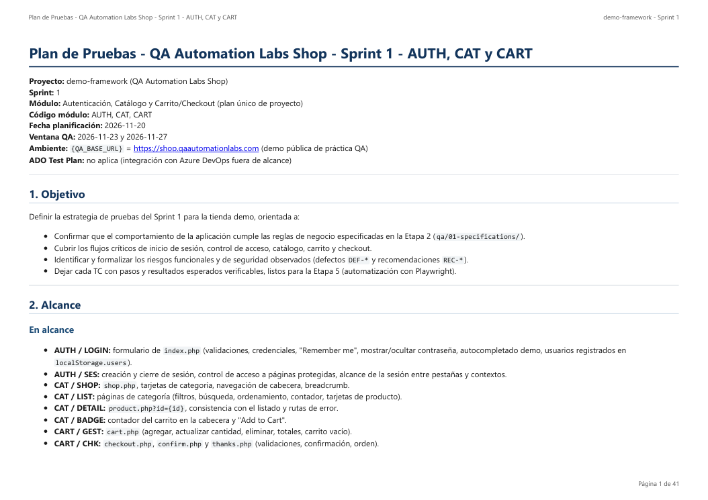
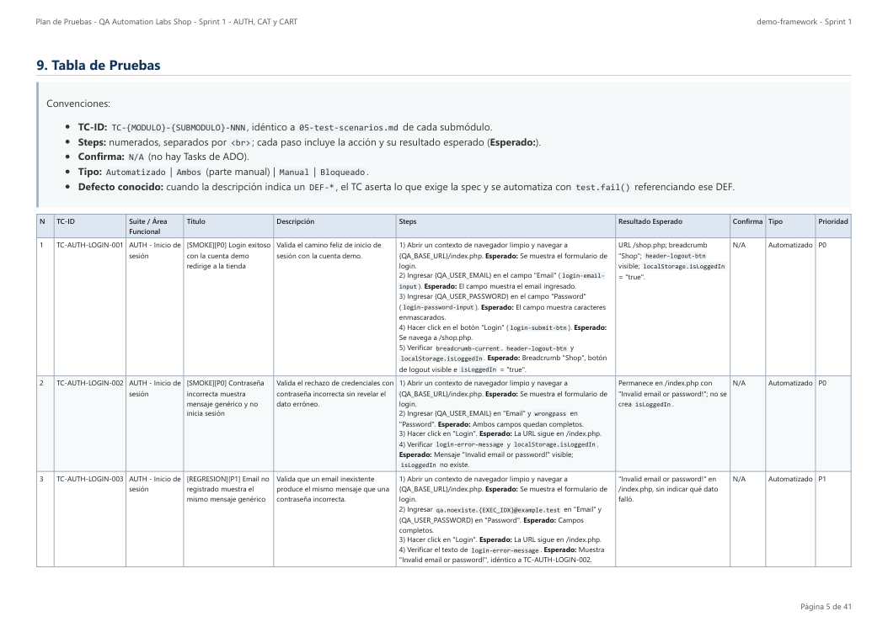
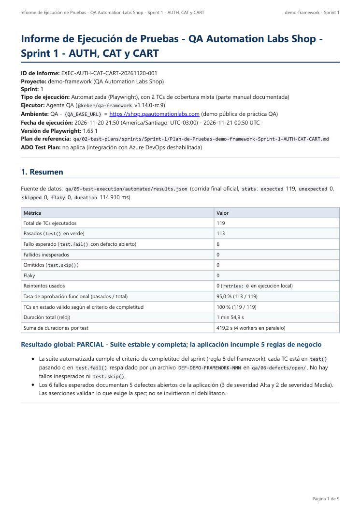
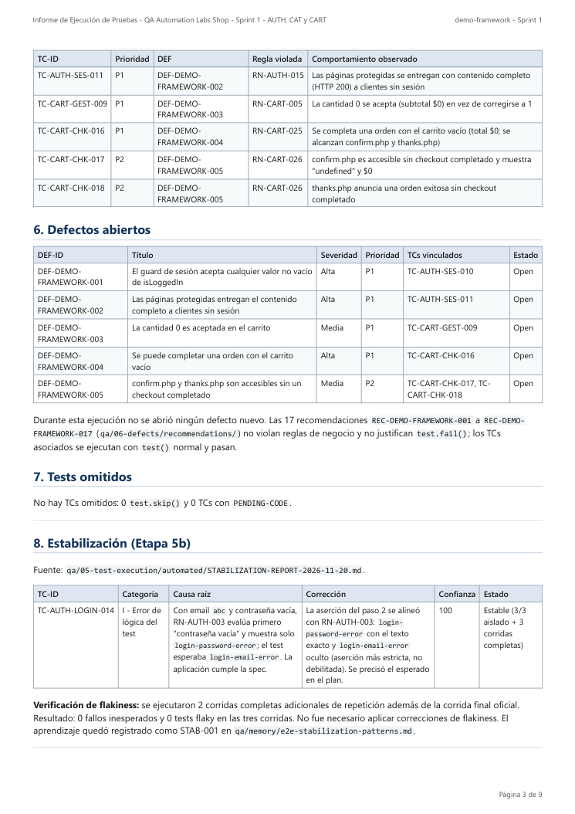

# demo-qaframework-qaautomationlabs

Demostración de las capacidades de [`@keber/qa-framework`](https://www.npmjs.com/package/@keber/qa-framework) aplicado con **Claude Code** sobre la tienda demo [shop.qaautomationlabs.com](https://shop.qaautomationlabs.com/shop.php).

Todo el contenido de este repositorio (configuración del framework, especificaciones, plan de pruebas, automatización E2E con Playwright, estabilización, defectos, recomendaciones e informes finales en PDF) fue generado por Claude a partir de **un único prompt**. No hubo edición manual de los artefactos.

## El prompt

Este fue el prompt inicial. Bastó para generar el contenido del repositorio, incluidos los informes finales:

```text
Crea un nuevo directorio llamado demo-framework, instala y configura el paquete npm
@keber/qa-framework@next en dicha carpeta, configurando como proyecto a testear
https://shop.qaautomationlabs.com/shop.php , el usuario es "demo@demo.com" y la
contraseña o password es "demo".

Nota: La web objetivo del proyecto es un sistema de demostración, e intencionalmente
publica un usuario y contraseña para exploración y ejecución de pruebas, por lo que en
este caso particular colocar la password en la sesión de claude no constituye una
brecha de seguridad.

Una vez configurado el framework, coordina sub-agentes modelo Opus 5.5 Medio para que
ejecuten las etapas del pipeline del framework hasta las pruebas end to end con
playwright y la etapa de healing, sin incluir integración con Azure DevOps. Finalmente,
genera los informes de análisis de pruebas, plan de pruebas y ejecución de pruebas en PDF.
```

> Las credenciales del prompt corresponden a la cuenta pública de demostración que publica el propio sitio. Aun así, el código nunca las contiene: la automatización las lee desde variables de entorno (`QA_USER_EMAIL`, `QA_USER_PASSWORD`) y la documentación usa `<PLACEHOLDER>`.

## Cómo se ejecutó

Claude actuó como orquestador: instaló y configuró el framework, y delegó cada etapa del pipeline en sub-agentes (Claude Opus 5.5, esfuerzo medio).

| Etapa | Skill del framework | Resultado |
|---|---|---|
| 1-2 Análisis y especificaciones | `qa-module-analysis`, `qa-spec-generation` | 3 módulos en paralelo (AUTH, CAT, CART), 8 submódulos, 119 escenarios, 81 reglas de negocio, 24 flujos |
| 3-4 Plan y casos de prueba | `qa-test-plan`, `qa-test-cases` | Plan de Pruebas con 119 TCs (P0: 22, P1: 48, P2: 39, P3: 10), 5 defectos y 17 recomendaciones |
| 5 Automatización E2E | `qa-automation` | 119 tests Playwright con page objects y locators `data-testid` |
| 5b Healing | `qa-test-stabilization` | 1 test corregido (TC-AUTH-LOGIN-014), 2 corridas extra sin tests inestables |
| Informes | - | Informe de Análisis, Plan de Pruebas e Informe de Ejecución en PDF |

### Resultado final

| Métrica | Valor |
|---|---|
| Casos de prueba | 119 |
| Pasan | 113 |
| Fallan como se espera (`test.fail()` sobre defecto abierto) | 6 |
| Fallos inesperados | 0 |
| Tests inestables (flaky) | 0 |
| Duración de la corrida | 1 min 55 s (4 workers, Chromium) |

Defectos abiertos detectados en la aplicación:

| ID | Título | Severidad |
|---|---|---|
| DEF-DEMO-FRAMEWORK-001 | El guard de sesión acepta cualquier valor no vacío de `isLoggedIn` | Alta |
| DEF-DEMO-FRAMEWORK-002 | Las páginas protegidas entregan el contenido completo a clientes sin sesión | Alta |
| DEF-DEMO-FRAMEWORK-003 | La cantidad 0 es aceptada en el carrito | Media |
| DEF-DEMO-FRAMEWORK-004 | Se puede completar una orden con el carrito vacío | Alta |
| DEF-DEMO-FRAMEWORK-005 | `confirm.php` y `thanks.php` son accesibles sin un checkout completado | Media |

## Informes

Los PDF están en [`qa/09-reports/`](qa/09-reports/).

### Informe de Análisis de Pruebas

[Informe-de-Analisis-de-Pruebas.pdf](qa/09-reports/Informe-de-Analisis-de-Pruebas.pdf) (6 páginas)

| Portada | Contenido |
|---|---|
|  |  |

### Plan de Pruebas

[Plan-de-Pruebas.pdf](qa/09-reports/Plan-de-Pruebas.pdf) (41 páginas)





### Informe de Ejecución de Pruebas

[Informe-de-Ejecucion-de-Pruebas.pdf](qa/09-reports/Informe-de-Ejecucion-de-Pruebas.pdf) (9 páginas)

| Portada | Defectos y estabilización |
|---|---|
|  |  |

## Estructura del repositorio

| Ruta | Contenido |
|---|---|
| `qa/qa-framework.config.json` | Configuración del proyecto (URL, módulos, usuarios de prueba, Playwright) |
| `qa/01-specifications/` | Especificaciones por módulo y submódulo (inventario, reglas, flujos, roles, datos, escenarios) |
| `qa/02-test-plans/` | Plan de Pruebas e Informe de Análisis (Markdown) |
| `qa/05-test-execution/` | Resultados JSON/HTML, informe de estabilización e Informe de Ejecución |
| `qa/06-defects/` | Defectos abiertos y recomendaciones |
| `qa/07-automation/e2e/` | Proyecto Playwright: tests, page objects, fixtures |
| `qa/09-reports/` | Informes finales en PDF |
| `qa/memory/` | Aprendizajes registrados por los agentes |
| `.claude/`, `.github/` | Reglas, comandos y skills del framework para agentes |

## Ejecutar las pruebas

Requisitos: Node.js 18 o superior.

```bash
npm install
cd qa/07-automation/e2e
npm install
npx playwright install chromium
```

Defina las credenciales de la cuenta demo como variables de entorno (o en `qa/07-automation/e2e/.env`, que está excluido de git) y ejecute la suite:

```bash
export QA_BASE_URL=https://shop.qaautomationlabs.com
export QA_LOGIN_PATH=/index.php
export QA_USER_EMAIL=<PLACEHOLDER>
export QA_USER_PASSWORD=<PLACEHOLDER>
QA_LANE_ONLY=1 npx playwright test --project=chromium --project=login-flow --workers=4
```

En Git Bash para Windows, anteponga `MSYS_NO_PATHCONV=1` para que `/index.php` no se convierta en una ruta de Windows.

## Limitaciones

- La aplicación bajo prueba es un sitio público de terceros: los resultados dependen de su estado en el momento de la ejecución.
- La sesión y el carrito de la aplicación existen solo en el navegador (`localStorage`), lo que explica parte de los defectos detectados.
- El objetivo de escenarios por submódulo se redujo a 8-20 (el valor por defecto del framework es 50-85) para mantener la demostración acotada.
